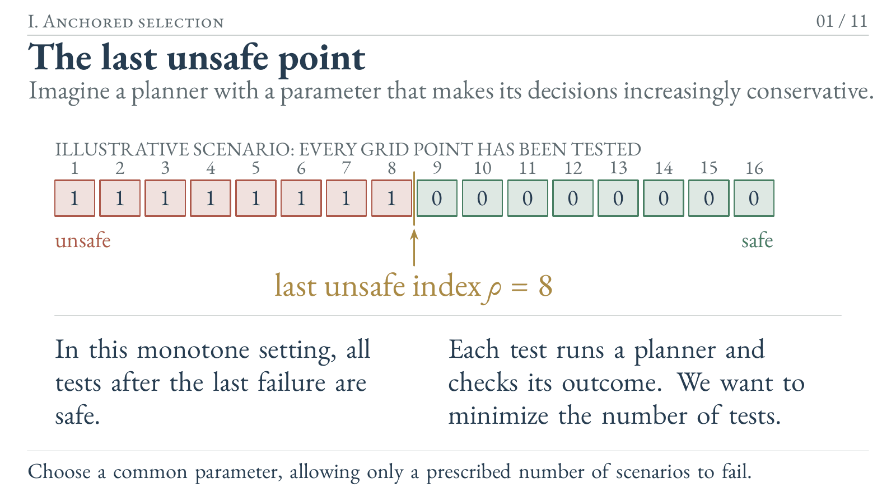
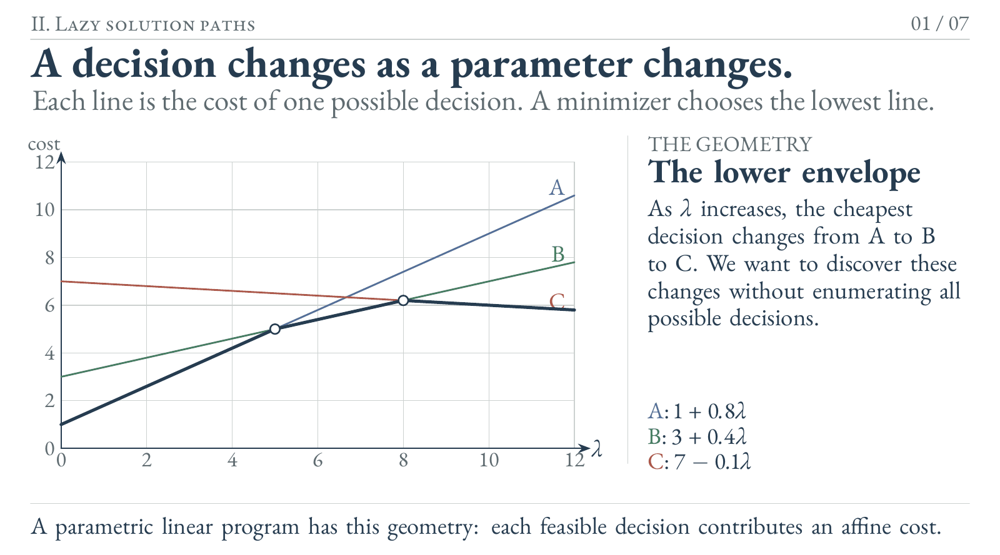
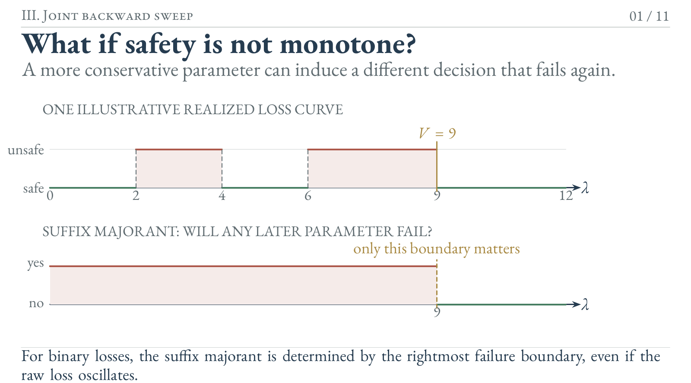

> *Frustra fit per plura, quod potest fieri per pauciora.*
>
> — William of Ockham, *Summa Logicae*, I.12

In early 1943, the statistician W. Allen Wallis had the rather unenviable task of informing an irascible US Navy captain, Garret L. Schuyler, that a mathematical approximation the latter had devised was erroneous.

As Wallis recounts in his delightful essay, [The Statistical Research Group, 1942–1945](https://doi.org/10.1080/01621459.1980.10477469):

> He barked, “How good is it?” and I replied “No good at all.”

Curiously enough, the two subsequently became good friends.

Of considerably greater mathematical consequence was a problem Schuyler raised in the course of their subsequent discussions. Some of the experiments conducted by the Navy necessitated several thousand trials, whereas an experienced observer might recognise the futility of continuing an experiment after only a few hundred. Could one devise an objective mathematical criterion for terminating it prematurely?

Wallis and Milton Friedman realised that even in conventional fixed-sample tests, circumstances could arise in which no conceivable outcome of the remaining trials would alter the conclusion. They subsequently brought the problem to Abraham Wald, whose investigations culminated in the theory of [sequential analysis](https://doi.org/10.1214/aoms/1177731118).

A problem of somewhat analogous character arises in batch conformal decision theory, albeit with the expenditure being computational rather than experimental.

## I. The counterfactual problem

Consider a robot attempting to navigate a vicinity populated by pedestrians. Its planner has some adjustable parameter $\lambda$ determining the relative importance it attaches to safety vis-à-vis making progress towards its destination.

How cautious ought the robot to be?

One means of answering this question, drawing upon [Conformal Decision Theory](https://conformal-decision.github.io/), involves taking a collection of previously observed scenes and asking what would have transpired had the robot employed different values of $\lambda$.

Such counterfactual evaluations are, unfortunately, not particularly cheap: each may entail solving an optimization problem and evaluating its consequences.

Suppose, for the moment, that increasing $\lambda$ can never turn a safe outcome into an unsafe one. Associated with each scene is then a number $\rho_i$, denoting the last unsafe index on our grid of possible parameters.

If we can afford two failures amongst our calibration scenes, we need only determine the third-largest $\rho_i$ and choose the succeeding grid point.

This is essentially a problem of finding an order statistic.

## II. Quickselect on numbers we do not know

In 1961, C. A. R. Hoare published three algorithms in the *Communications of the ACM*: Partition, Quicksort and [Find](https://doi.org/10.1145/366622.366647). The last of these is the progenitor of what is now commonly called Quickselect.

There is no necessity to sort a collection of numbers merely to ascertain its third-largest element. Pick a number, count how many elements exceed it, and confine subsequent investigations to the appropriate subset.

Now, the rather nice observation here is that **we need not even know the numbers themselves.**

Suppose we have ascertained, by binary search, that $\rho_4=8$. Consider another scene. If it is unsafe at grid point 9, its last unsafe index necessarily exceeds 8. If it is safe at grid point 8, its index must be smaller. The remaining possibility is equality.

Thus, at most two counterfactual evaluations suffice to compare an otherwise unknown number with our chosen reference.

{width=100% fig-align="center"}

After an initial test at the least conservative grid point eliminates scenes that are always safe, only the randomly chosen reference numbers warrant a binary search. In the animation above, we ascertain the third-largest of eight numbers whilst leaving six of them unknown.

For $n$ calibration scenes and $J$ grid points, the consequence is a reduction from the $O(n\log J)$ query bound for independent binary searches to an expected $O(n+\log n\log J)$, which, for polynomially growing grid sizes, matches our worst-case lower bound up to constant factors (in the nontrivial budget regime).

## III. A curious consequence of nonmonotonicity

Of course, there is no a priori reason why attaching greater importance to *predicted* safety should invariably improve *realized* safety. Our predictions could be erroneous.

A scene may therefore alternate between safe and unsafe outcomes as we vary $\lambda$. Fortunately, for binary losses, conformal calibration still reduces to finding an order statistic of the rightmost failures:

$$
V_i=\sup\{\lambda:L_i(\lambda)=1\}.
$$

There is a particularly elegant computational consequence of this formulation.

Suppose the planner assigns each possible decision a cost of the form $a+\lambda b$. Geometrically, each decision is represented by a straight line, and the planner selects the lowest one.

In their [1976 paper](https://doi.org/10.1145/321978.321982) concerning the segmentation of records in large databases, Eisner and Severance developed a procedure for tracing such parametric solution paths.

The underlying geometry is quite lovely. Take two known optimal decisions, intersect their cost lines, and solve the optimization problem at precisely that intersection. Either a cheaper, previously unknown decision emerges, necessitating further subdivisions, or the two decisions are certified as adjacent on the open pieces of the path (ties being accounted for separately).

{width=100% fig-align="center"}

Now, what if we insist upon exploring the right-hand subdivision before the left?

We obtain an algorithm capable of furnishing the solution path piecemeal, in decreasing order of $\lambda$.

Better yet, suppose we have several such algorithms whose executions can be interleaved. We advance whichever has the rightmost unresolved event, abandoning each scene upon encountering its first failure.

The moment we encounter our third distinct failure, the remaining computations can be suspended altogether: none of their undiscovered failures can lie further to the right. We choose a parameter strictly above this boundary (or employ the safe fallback).

{width=100% fig-align="center"}

What I find particularly pleasing is that a statistical criterion now dictates the traversal of a half-century-old optimization algorithm.

In one of our set-covering experiments, this reduced the number of linear programs solved from 23,128 to 750, without altering the calibration boundary.

We have not devised a cheaper approximation to the answer. We have devised a means of obtaining the very same answer whilst leaving much of the problem unsolved.

One suspects Captain Schuyler would have approved.

---

[Read the manuscript](https://www.alphaxiv.org/pdf/2611.batch-conformal-counterfactual-evaluations) · [Code and numerical experiments](https://github.com/ImperatorAvrelianvs/batch-cdt)

The manuscript is a preprint and has not yet undergone peer review.
